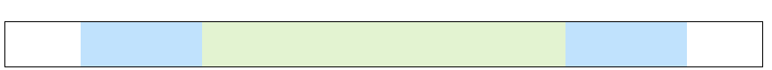

1
在面临从小到大的挑选问题时， 优先选择二分查找
2
在进行最少的数值相加时，不必急于将最节省的一项加进去，可以选择，每一项都正常得到和相加。将每一个正常的项与最节省的项相减，最后用累加值减去这个节省的数
3
你的程序复杂度越高，就越容易出错。
4
把两个字符串，一个不能变，把另一个插入到那个不变的里面，用字典顺序，把他们两个以最小的字典顺序合并输出。但其实并不必要把他两个真合并到一起，你只需要把能变得用从小到大排序，然后 把他们两个按从小到大输出就行了
5
字符总和问题 要注意变量的纯洁，不要被污染了。

6
// 下面代码的作用可用于记忆化代码. 这段代码的直观作用是返回第一个有值的坐标, 若是没有有值的返回0坐标
int index(int num,int n){
  for(int i = 0;i < n;i++){
    if(num[i] != 0) return i; 
  }
  return 0;
}

记忆化代码本质是将数据变为可存储，可查询的数据。

8
c 语言的 long , unsigned long , long long , unsigned long long 
long 的数据需要加 L  ，引用它需要%ld
unsigned long 数据需要加 UL  , %lu
long long 的 数据需要加 LL , %lld
unsigned long long 的数据需要加 ULL %llu

java 中使用long 
long 的数据需要L ， 引用他需要 %d;

编程心得
{//////////////////////////////////////////////////////////////////////////////////////////////////////////////////////////////////////////////////////////////////////////////////////////////////////////////////////////////////////////////////////////////////////////
项目名称
它要用英文，不要用中文和空格

}//////////////////////////////////////////////////////////////////////////////////////////////////////////////////////////////////////////////////////////////////////////////////////////////////////////////////////////////////////////////////////////////////////////

web前端设计心得
{//////////////////////////////////////////////////////////////////////////////////////////////////////////////////////////////////////////////////////////////////////////////////////////////////////////////////////////////////////////////////////////////////////////
1
尽量把标签像成一个正方形

2
很多时候先找到重点， 例如基线， 你不需要完全知道这个标签是怎么排列的， 但你要找到那个排列的主要因素。

3
页面设计
我们可以把页面分成好几个部分，每个部分当成一个整体，然后用一个单独的scss文件修饰它。

4
js 负责状态， css负责表现。
不要使用js给标签添加复杂的表现, 想要添加复杂表现通过添加类选择器实现。
}//////////////////////////////////////////////////////////////////////////////////////////////////////////////////////////////////////////////////////////////////////////////////////////////////////////////////////////////////////////////////////////////

web 设计
{//////////////////////////////////////////////////////////////////////////////////////////////////////////////////////////////////////////////////////////////////////////////////////////////////////////////////////////////////////////////////////////////
1
;
这个结构式， 在一行中，一个宽距固定，高不固定的大框居中， 在这个大框中， 有两个宽高固定的小框左右浮动
在这个结构中，我们通常用一个

 包裹，这个

 的display属性是 inline-block, 他要在这一行居中， 可以使用margin:0 auto;， 给这个
设置一个宽。
在这个

中， 我们可以设置两个display为inline-block的 

， 然后给这两个
 浮动， 一个左浮动， 一个右浮动。记得给这两个div 设置宽高。

2
标签 |  标签
这个结构中，你想要实现中间的竖线，你可以利用display:flex; 的gap,设定好gap的值。
然后在父标签中正常排序，

 

 

然后把中间的
标签修改成竖线形式就行了

你也可以通过position 和 伪元素实现

3
标签 标签
————————
在这个结构中，你若是想实现 底边的竖线你可以利用 伪元素来实现
通过在一个宽一定的父元素设置 after伪元素，你需要把伪元素设置的比较长，这样伪元素就能自动换行。
然后你可以利用居中达到结构效果
}//////////////////////////////////////////////////////////////////////////////////////////////////////////////////////////////////////////////////////////////////////////////////////////////////////////////////////////////////////////////////////////////

设计模式
{//////////////////////////////////////////////////////////////////////////////////////////////////////////////////////////////////////////////////////////////////////////////////////////////////////////////////////////////////////////////////////////////////////////
1
设计模式原则:
原则1：找出应用中可能变化之处，把它们独立出来，不要和那些不变化的代码混在一起
原则2：针对超类编程，而不是针对现实编程。

2
原则解释：
原则1：

原则2：
这里的超类可以指的是接口，也可以是抽象类。接口和抽象类都可以看成一个模板，一句这个模板实现类，而由这个类产生的对象可以被声明为超类
接口里面只有抽象方法，default方法，常量，它不能new出来。抽象类里面有一个类该有的全部， 而且还有抽象方法，只不过它不能new 出来。
}//////////////////////////////////////////////////////////////////////////////////////////////////////////////////////////////////////////////////////////////////////////////////////////////////////////////////////////////////////////////////////////////////////////
